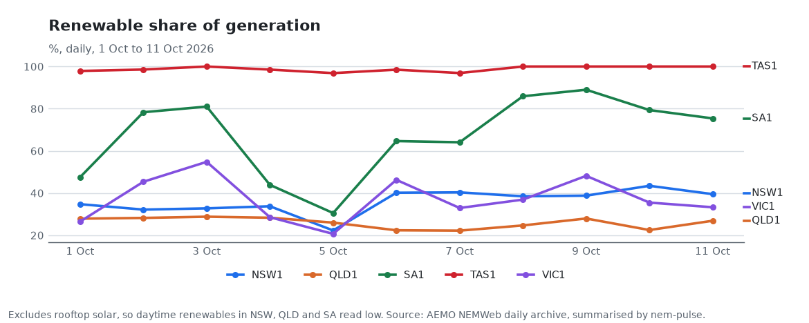

# nem-pulse

A small public dataset of daily summaries for Australia's National Electricity Market (NEM). A scheduled GitHub Action keeps it up to date.

[](https://github.com/Guinerve/nem-pulse/actions/workflows/ci.yml)
[](https://github.com/Guinerve/nem-pulse/actions/workflows/daily.yml)
[](LICENSE)



Every morning the Action downloads the AEMO archive files for the newest days. It reduces them to one row per region per day: prices, demand, generation mix and emissions intensity. Then it commits the CSV files, redraws the charts and rewrites the [Latest](#latest) section below.

I built it to try the "git scraping" pattern on grid data: the repository is the dataset, and the commit history shows when each number arrived. Everything runs in a scheduled GitHub Action, so there is no server to maintain.

## Latest

<!-- PULSE:START -->
_Updated for 2026-10-11 (NEM time)._

| Region | Avg price | Renewables | Intensity | Negative price intervals |
|---|---:|---:|---:|---:|
| NSW1 | $134/MWh | 39% | 504 g/kWh | 34 |
| QLD1 | $109/MWh | 27% | 620 g/kWh | 96 |
| VIC1 | $3/MWh | 33% | 772 g/kWh | 162 |
| SA1 | -$28/MWh | 75% | 104 g/kWh | 164 |
| TAS1 | $6/MWh | 100% | 0 g/kWh | 140 |
| NEM | $82/MWh | 38% | 573 g/kWh | 82 |

### Recent records

- **2026-10-11** NEM: lowest price (-71.6 $/MWh, previous best -9.5 $/MWh)
- **2026-10-11** NEM: most intervals with a negative price (82 intervals, previous best 13 intervals)
- **2026-10-11** NSW1: lowest price (-9.6 $/MWh, previous best -5.6 $/MWh)
- **2026-10-11** NSW1: most intervals with a negative price (34 intervals, previous best 2 intervals)
- **2026-10-11** NSW1: highest solar share (23.4%, previous best 20.5%)
- **2026-10-11** QLD1: highest solar share (16.3%, previous best 15.9%)
- **2026-10-11** SA1: lowest price (-415.0 $/MWh, previous best -294.4 $/MWh)
- **2026-10-11** SA1: most intervals with a negative price (164 intervals, previous best 158 intervals)
- **2026-10-11** VIC1: lowest price (-365.2 $/MWh, previous best -148.4 $/MWh)
- **2026-10-10** NEM: highest price (8,854.9 $/MWh, previous best 594.3 $/MWh)
<!-- PULSE:END -->

The AEMO daily archive is about two days behind the grid, so the newest day here is two days old. I found this when the first scheduled run asked for "yesterday" and got a 404.

## What is in the data

| File | Content |
|---|---|
| `data/YYYY/MM/DD.csv` | One file per day. One row for each region (NSW1, QLD1, SA1, TAS1, VIC1) and one for the whole NEM. |
| `data/latest.csv` | The newest 30 days in one file. |
| `data/records.csv` | Days that set a new high or low for a region, compared with all earlier days in this dataset. |
| `assets/*.png` | Charts of renewable share, average price and emissions intensity for the last 60 days. |

Each daily row has these columns:

- `avg_price`, `min_price`, `max_price` in $/MWh, from the 288 five minute dispatch intervals.
- `negative_intervals`: the number of intervals with a price below zero.
- `avg_demand_mw`, `max_demand_mw`: operational demand.
- `generation_mwh` and the share of it from renewables, wind, solar, coal, gas, hydro and batteries.
- `intensity_g_per_kwh`: emissions intensity in g CO₂e/kWh.

The NEM row uses a price weighted by regional demand for each interval.

## Quick start

You need Python 3.11 or later and [uv](https://docs.astral.sh/uv/).

```bash
git clone https://github.com/Guinerve/nem-pulse.git
cd nem-pulse
uv sync
uv run nem-pulse --date 2026-10-10 --days 1
```

The last command downloads 10 October 2026 again. It then rewrites `data/latest.csv`, the charts and the Latest section of the README. The CSV file for that day does not change, so the output says `unchanged`.

Other examples:

```bash
uv run nem-pulse                              # the newest archived day (NEM today minus 2)
uv run nem-pulse --date 2026-10-10 --days 10  # 1 to 10 October 2026
uv run nem-pulse --help                       # all options
```

To read the data without installing anything, open a CSV file on GitHub or load it with pandas:

```python
import pandas as pd
df = pd.read_csv("https://raw.githubusercontent.com/Guinerve/nem-pulse/main/data/latest.csv")
```

## How it works

1. The workflow in `.github/workflows/daily.yml` runs at 20:30 UTC (06:30 AEST) each day.
2. It fetches the last 3 archived days. A day that AEMO publishes late is picked up on the next run.
3. The [`nem`](https://github.com/Guinerve/nem-mcp) client downloads the NEMWeb price and SCADA archive files for each day.
4. `summarise_day` joins SCADA output to a generator list with fuel types and emission factors. It then sums each day per region.
5. `store.write_day` writes the CSV only when its content changed.
6. `find_records` compares each new day with all earlier days. It starts after 7 days of history.
7. The workflow commits only when a file changed.

If source data is missing or incomplete, the run stops with exit status 2. Examples are an empty file, fewer than 285 of 288 intervals, a missing price or demand value, or a failed download. The workflow then fails and commits nothing. A README without the `PULSE` markers also stops the run.

The workflow token can only read by default. Only the data job can write, and it uses the token only for the final `git push`. Actions are pinned to commit SHAs.

## How I know it is right

I compared the daily figures with AEMO's published "Aggregated price and demand" CSV files. The script is `scripts/reconcile.py` and the output is in `docs/reconciliation-2026-10.txt`. It covers 50 region days, 1 to 10 October 2026.

| Check | Largest difference | Mean difference |
|---|---:|---:|
| Daily average price | 0.0049 $/MWh | 0.0026 $/MWh |
| Daily average demand | 0.048 MW | 0.027 MW |
| Daily maximum price | 0.0000 $/MWh | |
| Intervals per day | 288 in both sources, every day | |

The small differences come from rounding. To run the check again:

```bash
uv run python scripts/reconcile.py 202610
```

## Limits

- Generation shares use SCADA data for scheduled and semi-scheduled units. **Rooftop solar is not included.** The renewable share is therefore too low in daylight hours, most of all in NSW, QLD and SA.
- Records compare a day only with the history in this dataset. It starts on 1 October 2026, so the current records beat only 7 to 9 earlier days.
- Only price and demand are checked against AEMO. I have not yet checked the generation mix or emissions intensity against another source.
- The figures are daily and derived from AEMO data. This is not an official AEMO dataset.

## Roadmap

- Backfill a longer history from the archive, so that records mean more.
- Add rooftop solar estimates to the generation mix.

## Development

```bash
uv sync
uv run pytest -q        # 20 tests, no network needed
uv run ruff check .
```

The tests use synthetic interval data. They cover the daily summary, the checks that stop a bad run, the CSV store, record detection, the README rewrite and the command line exit codes.

## Licence

MIT. See [LICENSE](LICENSE).
